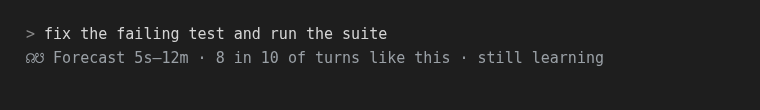
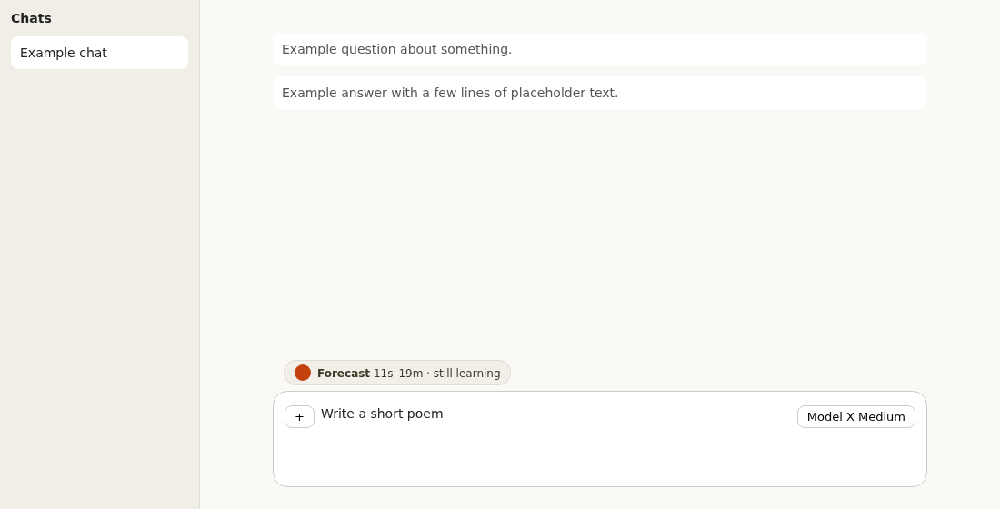

# First run: what a new user sees

Every install starts with no history of its own. Whatever Forecast shows on
the first turns is the product for that user, so the rule below decides how
sure the range is allowed to look before Forecast knows the person.

## The rule

A user's own **good turns** are counted the same way everywhere (finished, not
stopped, not failed, not during an incident). The range depends on that count:

| Own good turns | Range source `global` (default) | Range source `local` |
| -- | -- | -- |
| 0–9 | Shared-model range, **always the wide one (8 in 10)**, marked "still learning" | No range: "Forecast is learning your pace. Ranges start after 10 turns." |
| 10–29 | Shared-model range at the chosen width, or your own range once it has been closer for you | Your own range, **always the wide one**, marked "still learning" |
| 30+ | Shared-model range, or your own once it has been closer | Your own range at the chosen width |

The thresholds are `MIN_READY = 10` and `CONFIDENT = 30`
(`plugin/scripts/raindragon_eta/predict.py`, `extension/lib/predict.js`). The
plugin, the CLI hooks and the extension use the same rule. Below 10 turns the
shared model knows nothing about this person, so the band stays wide whatever
the setting. A fresh install never shows a range as tight as a calibrated
one. On the extension the shared model is a coding-turn model, and chat replies
are shown the same way: "still learning" until 10 replies.

Tests: `test_new_user_gets_the_wide_band_marked_learning_whatever_the_setting`
and `test_first_prompt_shows_the_global_band` (pytest),
`global: a range from the first reply, marked still learning` and
`global: past 10 replies the chosen band, no longer learning` (node), plus the
local-rule tests in `tests/test_plugin.py`.

## Zero history, shown

Made with `tools/first_run_screenshot.py`. It runs the real hook on an empty
data dir and the real extension libraries on an empty history, and draws the
extension pill over the synthetic test page (no real site or content).

Claude Code, first prompt of a new install:



```
☊☋ Forecast 5s–12m · 8 in 10 of turns like this · still learning
```

Extension, first reply of a new install:



```
Forecast 11s–19m · still learning
```

The range is wide on purpose: it says how little we know yet.

## What the shared model was fitted from

The shipped model file carries its own size: `trained_on` in
`plugin/scripts/raindragon_eta/turn_model.json` (also in
`extension/lib/turn_model_data.js`). Today that is 72,362 turns from 337
people, version `global-turn-1`. `/forecast:doctor` prints it under
`model.trained_on`, so anyone can check whether the model is stale.

## Accepted risk at launch

Forecast is calibrated per person only once it has that person's history. The
shared model was checked across people (leave-people-out on 337 people: 50.4%
of turns inside the 50% range, 80.2% inside the 80% range), but those people
are public coding-agent sessions, not our users, and on the one long real
plugin history we have, the shared 50% range held only 42.7% of the time.
Another model in this codebase did 1.9x worse out of sample once it was
checked. So the error for a new user is not measured at launch, and we accept
that. We limit it by showing only the wide range, labelled "still learning",
until the user has 10 turns of their own. After that, each user's own replay
(`/forecast:stats`, the extension options page) shows how often the range held
for them. The beta (RAI-332) collects that per user before we claim any
coverage number.
